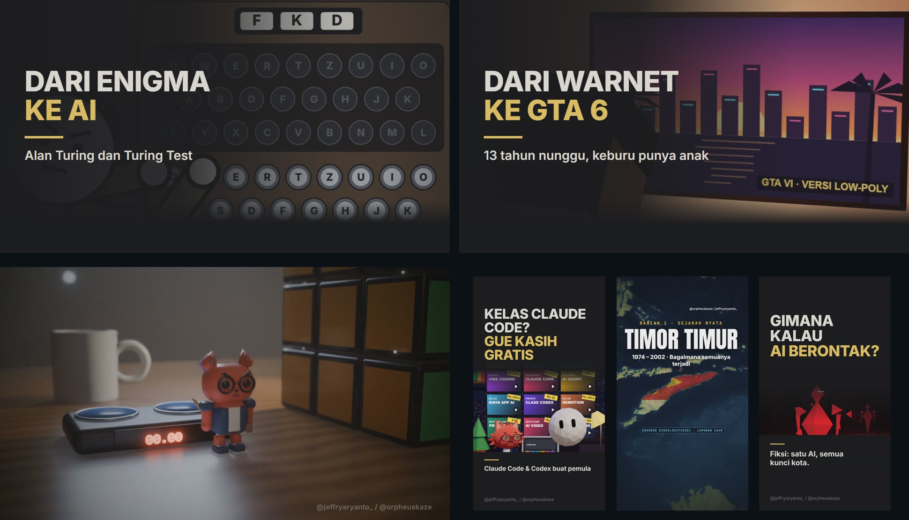

<h3>
  Hey! Nice to meet you 👋
  
  
</h3>

I make short explainer videos with code and AI agents. That means 2D stickman documentaries, low-poly 3D stories, Blender shorts and tutorials for beginners. Everything is scripted, animated and exported from code with Remotion, Three.js and Blender, then posted as Reels.

**video & motion**
 

**agents / ai**
 

**languages**
 

**web**
 

### Open kits (free, for learning)

| Repo | What it is |
|---|---|
| [stickman-story](https://github.com/ahmadaryanto/stickman-story) | Starter kit for 2D stickman documentary videos in Remotion |
| [vertical-reels-video-studio](https://github.com/ahmadaryanto/vertical-reels-video-studio) | Tutorial and agent skills for narrated 9:16 explainer Reels |
| [rubik-cat](https://github.com/ahmadaryanto/rubik-cat) | Skill for a Blender + GSAP mascot film: a toy cat tries to fix a Rubik's cube |
| [blender-skill](https://github.com/ahmadaryanto/blender-skill) | Agent skill for making Blender videos |
| [FPS-3d-skills-](https://github.com/ahmadaryanto/FPS-3d-skills-) | Scripts for a 3D first-person shooter scene video |
| [vibeyourtv](https://github.com/ahmadaryanto/vibeyourtv) | Debloat Android or Google TV over Wi-Fi, with an Apple TV-style home |
| [botdirectory.ai](https://github.com/ahmadaryanto/botdirectory.ai) | Open-source directory of agent-bot prompts |
| [virtual-office](https://github.com/ahmadaryanto/virtual-office) | 2D virtual office that shows AI agent status |

These are the simplified, public versions made for learning. My full production setup stays private.
